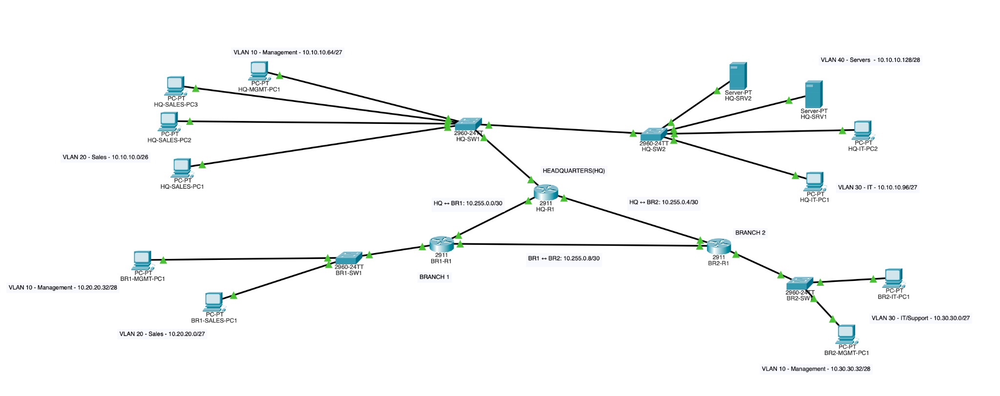

# Multi-Site Enterprise Network Infrastructure Lab

**Cisco Packet Tracer | Network Design, Routing, Services, Security & Resiliency**

## Overview

Designed and implemented a simulated enterprise network connecting a headquarters site and two branch offices. The lab demonstrates IP subnet planning, VLAN segmentation, inter-VLAN routing, dynamic WAN routing, centralized DHCP/DNS services, access control, secure router administration, and routing failover.

This is a **simulation/portfolio lab**, not a production deployment.

## Network architecture

- **Sites:** Headquarters (HQ), Branch 1, and Branch 2.
- **LAN segmentation:** Departmental VLANs on access switches; 802.1Q router-on-a-stick subinterfaces provide inter-VLAN routing.
- **WAN:** Three routers form a triangle, providing an alternate path if a direct site-to-site link fails.
- **Routing:** OSPF area 0 advertises local networks and learns remote subnets.
- **Central services:** HQ-SRV1 (`10.10.10.130`) provides DHCP and DNS to clients at all sites.
- **Administration:** SSHv2 with local login authentication for remote router management.

### Addressing plan

| Site | VLAN / Segment | Subnet | Default gateway / link addresses |
| --- | --- | --- | --- |
| HQ | VLAN 10 — Management | `10.10.10.64/27` | `10.10.10.65` |
| HQ | VLAN 20 — Sales | `10.10.10.0/26` | `10.10.10.1` |
| HQ | VLAN 30 — IT | `10.10.10.96/27` | `10.10.10.97` |
| HQ | VLAN 40 — Servers | `10.10.10.128/28` | `10.10.10.129` |
| Branch 1 | VLAN 10 — Management | `10.20.20.32/28` | `10.20.20.33` |
| Branch 1 | VLAN 20 — Sales | `10.20.20.0/27` | `10.20.20.1` |
| Branch 2 | VLAN 10 — Management | `10.30.30.32/28` | `10.30.30.33` |
| Branch 2 | VLAN 30 — IT/Support | `10.30.30.0/27` | `10.30.30.1` |
| WAN | HQ ↔ Branch 1 | `10.255.0.0/30` | HQ `.1`, Branch 1 `.2` |
| WAN | HQ ↔ Branch 2 | `10.255.0.4/30` | HQ `.5`, Branch 2 `.6` |
| WAN | Branch 1 ↔ Branch 2 | `10.255.0.8/30` | Branch 1 `.9`, Branch 2 `.10` |

## Implemented capabilities

### Switching and inter-VLAN routing
- Configured departmental VLANs, access ports, and 802.1Q trunks.
- Implemented router-on-a-stick for gateways and communication between permitted VLANs.

### OSPF and WAN redundancy
- Configured OSPF across the three-router WAN.
- Verified neighbor adjacencies and learned routes.
- Simulated failure of the HQ–Branch 1 direct link by shutting down HQ-R1 `G0/1`.
- Confirmed HQ's route toward Branch 1 Sales changed from next hop `10.255.0.2` to `10.255.0.6`, traversing Branch 2.
- Restored the interface and verified both OSPF neighbor adjacencies returned to FULL.

### Centralized DHCP and DNS
- Configured DHCP scopes for HQ and both branches on HQ-SRV1.
- Configured `ip helper-address 10.10.10.130` on client-facing router subinterfaces to relay DHCP requests across VLAN boundaries.
- Verified dynamic client leases, correct gateways, and remote server reachability.
- Configured DNS A records and verified name resolution from a branch client (`dhcp.corp.lab`).

### Traffic filtering
- Applied named extended IPv4 ACLs **inbound on Sales-facing router subinterfaces** at HQ and Branch 1.
- Denied Sales-originated traffic to Management VLANs at all three sites while permitting other traffic, including access to HQ servers.
- Inspected ACL match counters and tested expected permitted/denied connectivity.
- **Design limitation:** these are stateless ACLs, not stateful firewalls; return traffic to Management-initiated sessions may also be affected.

### Secure administration
- Enabled SSH version 2 on HQ-R1, BR1-R1, and BR2-R1.
- Configured local administrator authentication and SSH-only VTY access on configured lines.
- Verified remote SSH login to all three routers from an HQ IT workstation.

## Verification highlights

| Test | Observed result |
| --- | --- |
| Branch 1 Sales DHCP client | Received `10.20.20.10/27` via centralized DHCP |
| Branch 1 Management DHCP client | Received `10.20.20.37/28` via centralized DHCP |
| Branch 1 Management → local gateway | Ping 4/4 successful |
| Branch 1 Management → HQ-SRV1 | Ping 4/4 successful |
| Branch client DNS lookup | `dhcp.corp.lab` resolved to `10.10.10.130` |
| Sales → Management traffic | ACL deny matches observed; unauthorized ping blocked |
| Sales → HQ-SRV1 traffic | Permitted ping successful |
| SSH remote access | Successful authentication to all three routers |
| HQ–Branch 1 WAN shutdown | OSPF re-routed Branch 1 Sales via Branch 2 next hop `10.255.0.6` |
| WAN interface restoration | Both HQ OSPF adjacencies returned to FULL; subsequent HQ IT → Branch 1 Management ping succeeded |

## Files

- [`enterprisenetworklab.pkt`](enterprisenetworklab.pkt) — Packet Tracer topology and configurations.
- `screenshots/` — Planned evidence: topology, DHCP leases, DNS lookup, ACL match counters, SSH logins, and OSPF failover before/after.

### Open the lab

1. Install Cisco Packet Tracer (a compatible recent release).
2. Download `enterprisenetworklab.pkt` from this repository.
3. Open the file in Packet Tracer, switch to **Realtime** mode, and allow routing protocols to converge.
4. Inspect the routers, services, and clients; run the verification commands in this document.

> **Security note:** This is a teaching lab. Inspect and replace any demo credentials before sharing the topology outside a lab environment; never reuse these credentials on real devices.

## Key takeaways

This project strengthened hands-on skills in translating an addressing design into working interfaces, troubleshooting broadcast-based DHCP across routed networks, controlling traffic with source/destination-aware ACLs, validating SSH management access, and observing OSPF convergence after a WAN failure.

## Future improvements

Potential additions (not claimed as implemented): management-plane ACL restrictions, centralized AAA, logging/monitoring, documented port-security controls, and end-to-end ping evidence captured *during* the failover window.
